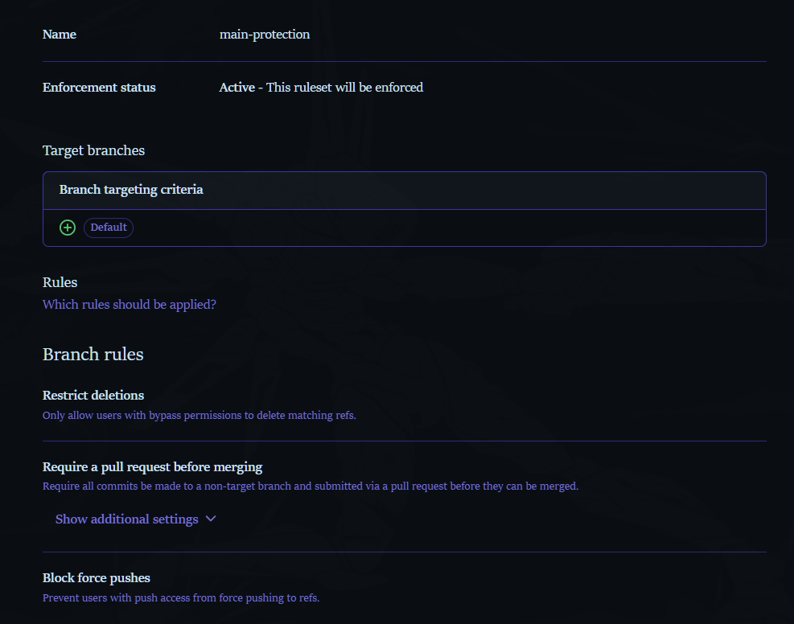

# Operations

How SmartCine is run, released, checked and watched. Sections 1 to 3 are written here; the later sections are filled by issue #11.

## 1. How to run and release

SmartCine runs as one web service on **Render** at **[URL: https://<service-name>.onrender.com]**. FastAPI serves both the API and the built React app.

A new version reaches production in three steps:

1. Open a pull request, get CI green and a review from another member, then merge it into `main`. The `main` ruleset requires a pull request and blocks force pushes and deletion. It does not require CI to pass, so a green run is a team rule, not a technical block.
2. CI runs on the merge commit (see section 2).
3. Render sees the new commit on `main` and deploys it automatically. Check that the deploy shows "Live" and that `/health` returns 200.

**Rollback (revert and redeploy).** Use this when a release breaks the app:

1. `git switch main && git pull`
2. `git revert <sha-of-the-bad-commit>` (add `-m 1` if it is a merge commit).
3. `git switch -c revert/<issue-number>` then `git push -u origin revert/<issue-number>`.
4. Open a PR with `Closes #<issue>`, wait for CI to go green, get a review, merge.
5. Render deploys the revert. Check `/health` again.

## 2. The CI pipeline

`.github/workflows/ci.yml` runs on every push and on pull requests to `main` and `develop`. A newer push to the same branch cancels the older run.

| Job | What it checks |
|---|---|
| Detect stack | Looks for `requirements.txt` (Python) and a root `package.json` (Node) to decide which jobs run. |
| Python tests | Python 3.12: installs `requirements.txt`, runs `ruff check` (warn only, never fails the run), then `pytest` with coverage. Fails if any test fails. |
| Node build and tests | Would run lint, test and build. It is currently **skipped**, because the repo has no root `package.json`; the frontend in `frontend/` is not built in CI. |
| No secrets committed | Scans tracked files for credential-looking strings, and fails if `.env`, `.sql`, `.sqlite` or `.dump` files are committed. |

A run takes about **[N] minutes**. Latest green run on `main`: **[link to the run]**.

Branch protection for `main` is the active ruleset `main-protection`. It requires a pull request before merging, blocks force pushes and restricts deletion. It has no "require status checks" rule.

## 3. Monitoring

**What is logged.** The app has no logging code of its own. Uvicorn writes its startup lines and one access line per request (method, path, status code) to standard output. On Render, read them under the service's **Logs** tab.

**What is never logged.** Passwords, login tokens and personal data. The login body and the `Authorization` header are not part of an access line, and the code never prints them.

**`/health`.** It opens the database and reads the `movie` table. It returns `200 {"status": "ok"}` if that works and `503 {"status": "unavailable"}` if not. An empty database file fails the check on purpose.

**Two numbers to watch.**

- **Error rate:** the share of requests answered with a 5xx status.
- **Response time:** how long requests take to be answered.

Both are on the service's **Metrics** tab on Render. We would notice a problem in three ways: Render's health check on `/health` fails and Render reports it, a deploy fails, or the 5xx share or response time on the Metrics tab jumps after a release.

## 4. Known risks and technical debt

| Item | Layer | What could happen | Plan |
|---|---|---|---|
| SQLite is on Render's ephemeral filesystem | infrastructure | Ratings, watch history, and account changes disappear after restart, spin-down, or redeploy. | accepted — this is a free demo; user data is not promised to persist, and the reset behavior is documented. |
| Vote counts for movie IDs 31–42 are rounded | data | Trending order and vote totals differ from the IMDb snapshot. | accepted — the 42-title catalog is demo seed data; refresh values from the permitted source before broader use. |
| BR2 age filtering and BR9 release-year tie-break are not built | code | Recommendations may violate age preferences or resolve ties differently from the requirement. | accepted — the current schema and CSV lack age-rating and release-year fields; add them before claiming these rules are enforced. |
| Sign-in attempts are not rate-limited | code | Repeated password guesses can target the public login endpoint. | accepted — the account is a documented demo account, not a public account service; add throttling before inviting real users. |
| Free Render service sleeps after 15 minutes idle | infrastructure | The first visit after sleep can take about a minute. | accepted — the free plan suits this class demo; the delay is documented for visitors. |
| Frontend has no automated UI tests | tests | A screen-flow regression can pass lint and build. | accepted — current CI checks lint/build and the P0 API flows are tested; add browser tests before expanding the UI. |

## 5. Maintenance plan

| Area | What to do | Owner | How often |
|---|---|---|---|
| Bugs | Triage reports, reproduce, add a regression test, and fix through a reviewed PR. | @KatsuroHuy | Weekly and on each report |
| Dependencies | Review Python and npm updates; run tests, frontend lint, and build before merging. | @th3dummyking | Monthly |
| Data backups | Keep `data/movies.csv` as the reviewed, versioned source and verify `python init_db.py` rebuilds SQLite; runtime user data has no backup on the free plan. | @phuonglinhtla | Before each release |
| Monitoring | Check Render deploy events/logs and `/health`; investigate non-200 health checks or repeated request errors. | @Nvhwng | Weekly and after deploys |
| Documentation | Check setup, operations, data-reset notes, and test commands against the live service and code. | @phuonglinhtla | After each release |
| Regression checks | Run `python -m pytest -v` and `cd frontend && npm run lint && npm run build`. | @KatsuroHuy | Every PR |

## 6. Lessons learned

1. **A passing happy path did not ensure genre filtering worked in cold-start mode.** TC-33 exposed the US06 bug (#106); we fixed the query and kept the regression test. Next time, write acceptance tests for each mode and filter before implementation.
2. **Ten seed movies per genre were not enough when watched movies were excluded.** Expanding to 14 per genre (#100) made the exact-ten cold-start case testable. Next time, size fixtures for exclusions and boundary cases during backlog refinement.
3. **A local SQLite file is convenient but does not survive the free host's lifecycle.** We documented the reset behavior and seed-on-start command. Next time, decide persistence from user-data requirements before deployment and make the limitation visible before collecting data.
