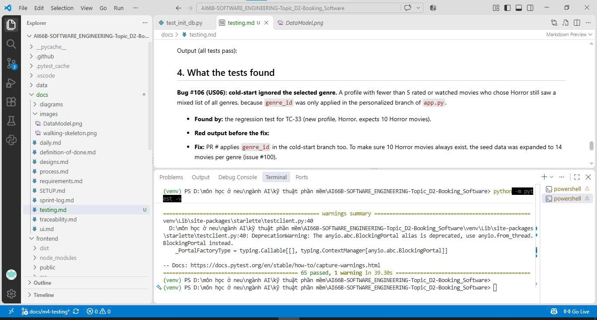
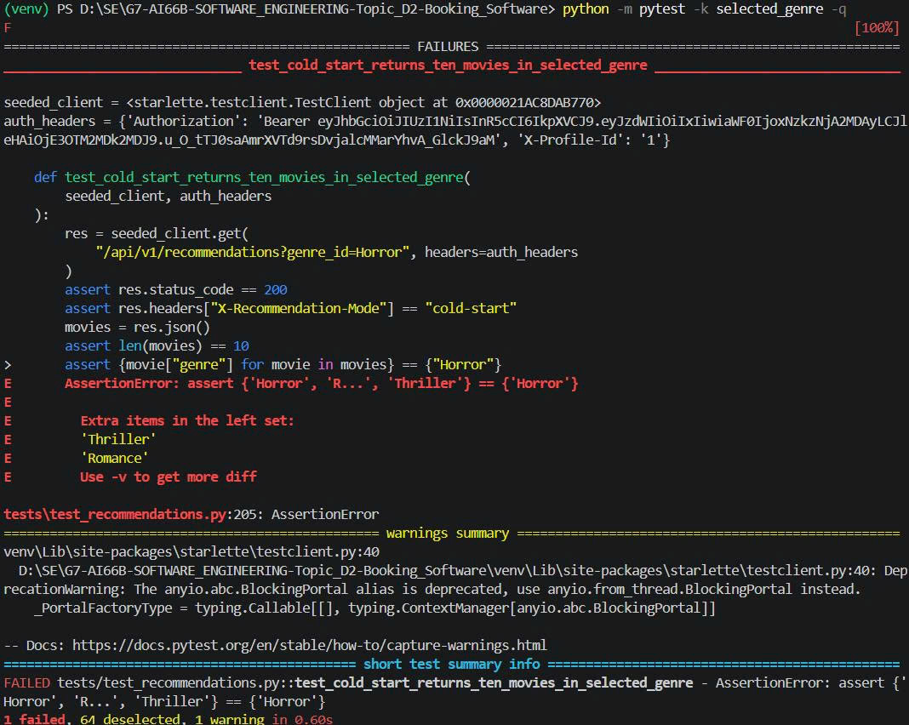

# Testing

SmartCine is tested with `pytest`. Every P0 story has automated tests that run with one command, without a server and without the real database (each test uses a temporary SQLite file).

```bash
python -m pytest -v
```

## 1. What we test, and why

| Layer | Test | Why |
|---|---|---|
| Services and routes (`app.py`, `auth.py`, `profiles.py`) | Tests with the FastAPI test client on a temporary SQLite database | All business rules live here (BR1 to BR10: thresholds, limits, who may see what). A mistake here costs the most. |
| Repository (`init_db.py` and the tables) | A few tests on a temporary SQLite file (`tests/test_init_db.py`) | Checks the seed data and the database constraints (score from 1 to 10, no duplicate rating, no duplicate IMDb id). These tests support all P0 stories, so they are not listed in the table in section 2, which lists the cases of each P0 story. |
| Interface (`frontend/`) | None automated; `npm run lint` and `npm run build` only | The screens were checked with real users in Milestone 3 and they still change often. |

**Risk.** We tested the recommendation rules most (cold-start versus personalized, the 5-movie and 100-vote thresholds, the maximum of 10 movies, the 6.0 rating limit), because a wrong list is the first thing a user sees and these rules have numbers that are easy to get off by one. We also tested ratings and watched movies carefully, because a bad rating or a watched movie that comes back breaks US02 and US04 directly. Profile isolation (BR10) is tested because mixing two profiles' data would be a privacy problem.

## 2. Test cases for every P0 story

| ID | Story | Input | Expected result | Kind |
|---|---|---|---|---|
| TC-01 | US10 Select a profile | Sign in with the demo account | 200, token and 2 profiles | normal |
| TC-02 | US10 Select a profile | Sign in with a wrong password | 401, no token returned | error |
| TC-03 | US10 Select a profile | Select a profile that belongs to another account | 404 (BR10) | error |
| TC-06 | US10 Select a profile | Alex rates 5 movies | Alex gets a personalized list, Sam still gets a cold-start list (BR10) | normal |
| TC-04 | US06 Choose a genre | Ask for the genre list | Horror, Romance and Thriller, once each | normal |
| TC-05 | US06 Choose a genre | Ask for the genre list without `X-Profile-Id` (no profile chosen) | 400 | error |
| TC-32 | US06 Choose a genre | Profile with 5 or more movies, choose Thriller | Every movie in the list is Thriller (personalized) | normal |
| TC-33 | US06 Choose a genre | New profile (cold-start), choose Horror | 10 Horror movies, each with 100 or more votes | normal (regression, bug #106) |
| TC-34 | US06 Choose a genre | Genre that does not exist ("Western") | 200, empty list | error |
| TC-07 | US01 Cold-start | Profile with 0 rated and 0 watched movies | 10 movies, each with 100 or more votes, mode cold-start | normal |
| TC-08 | US01 Cold-start | 4 rated or watched movies | Still cold-start | boundary, just below 5 |
| TC-09 | US01 Cold-start | A movie with 99 votes | Not in the list | boundary, just below 100 |
| TC-10 | US01 Cold-start | A movie with exactly 100 votes | In the list | boundary, on the limit |
| TC-11 | US01 Cold-start | Fewer than 10 movies with 100 or more votes | 503 `COLD_START_UNAVAILABLE` | error |
| TC-12 | US03 Personalized | Exactly 5 rated or watched movies | Personalized mode (BR5) | boundary, on the limit |
| TC-13 | US03 Personalized | Horror rated high, Romance rated low | A Horror movie is listed first | normal |
| TC-14 | US03 Personalized | More than 10 movies qualify | Exactly 10 returned (BR3) | boundary |
| TC-15 | US03 Personalized | A movie rated 5.9 and one rated 6.0 | 5.9 excluded, 6.0 kept (BR4) | boundary, both sides |
| TC-16 | US02 Rate a movie | Score 1 | 201, saved | boundary, lowest |
| TC-17 | US02 Rate a movie | Score 10 | 201, saved | boundary, highest |
| TC-18 | US02 Rate a movie | Score 0; score 11 | 400 "Rating must be between 1 and 10.", nothing saved | boundary and error |
| TC-19 | US02 Rate a movie | Rate the same movie again | Score overwritten, one row | normal |
| TC-20 | US02 Rate a movie | Unknown movie id; no token | 404; 401 | error |
| TC-21 | US04 Exclude watched | Mark a movie as watched | It is not in the next list | normal |
| TC-22 | US04 Exclude watched | Rate a movie | It is also marked watched and not recommended (BR1) | normal |
| TC-23 | US04 Exclude watched | 25 watched movies | None of them reappears | boundary |
| TC-24 | US04 Exclude watched | Mark the same movie twice; unknown movie id | Harmless; 404 | error |

## 3. Automated tests

One command runs all of them:

```bash
python -m pytest -v
```

Every test case ID above is in the name or a comment of a test:

| IDs | File |
|---|---|
| TC-01 to TC-06 | `tests/test_us06_us10.py` |
| TC-07 to TC-15, TC-32 to TC-34 | `tests/test_recommendations.py` |
| TC-16 to TC-24 | `tests/test_ratings_watch.py` |

Output (all tests pass):



## 4. What the tests found

**Bug #106 (US06): cold-start ignored the selected genre.** A profile with fewer than 5 rated or watched movies who chose Horror still saw a mixed list of all genres, because `genre_id` was only applied in the personalized branch of `app.py`.

- **Found by:** the regression test for TC-33 (new profile, Horror, expects 10 Horror movies).
- **Red output before the fix:**

  

- **Fix:** PR #113 applies `genre_id` in the cold-start branch too. To make sure 10 Horror movies always exist, the seed data was expanded to 14 movies per genre (issue #100).
- **Guard:** TC-33 stays as a regression test, and the old test that expected the genre to be ignored was reversed.