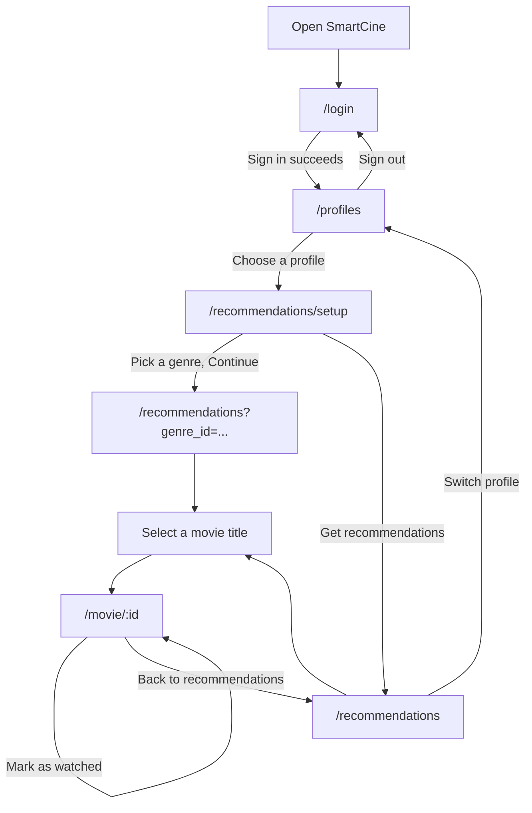

## 1. P0 stories and status
 
Status reflects what is on `main` at submission time. "Works" means the user can complete the story through the UI with real data. "Partly works" means the screen exists but one acceptance criterion is incomplete.
 
| Story | Screen(s) | Route(s) | Status | Issue |
|---|---|---|---|---|
| US10 — Select a profile before watching | Sign in, Who's watching? | `/login` → `/profiles` | Works | [#32](https://github.com/SE-FDA-NEU-AI66B/G7-AI66B-SOFTWARE_ENGINEERING-Topic_D2-Booking_Software/issues/32) |
| US06 — Ask for a theme before recommending | Genre picker | `/recommendations/setup` | Partly works — the genre filter only applies once a profile has 5 or more rated or watched movies; the cold-start list ignores it | [#27](https://github.com/SE-FDA-NEU-AI66B/G7-AI66B-SOFTWARE_ENGINEERING-Topic_D2-Booking_Software/issues/27), [#28](https://github.com/SE-FDA-NEU-AI66B/G7-AI66B-SOFTWARE_ENGINEERING-Topic_D2-Booking_Software/issues/28) |
| US01 — Cold-start recommendations | Recommendation list | `/recommendations` | Works | [#23](https://github.com/SE-FDA-NEU-AI66B/G7-AI66B-SOFTWARE_ENGINEERING-Topic_D2-Booking_Software/issues/23) |
| US03 — Personalized recommendations | Recommendation list | `/recommendations` | Works — genres the profile rates highest are listed first | [#25](https://github.com/SE-FDA-NEU-AI66B/G7-AI66B-SOFTWARE_ENGINEERING-Topic_D2-Booking_Software/issues/25) |
| US02 — Rate a watched movie | Movie detail | `/movie/:id` | Works | [#24](https://github.com/SE-FDA-NEU-AI66B/G7-AI66B-SOFTWARE_ENGINEERING-Topic_D2-Booking_Software/issues/24) |
| US04 — Exclude watched movies | Movie detail, recommendation list | `/movie/:id` → `/recommendations` | Works | [#26](https://github.com/SE-FDA-NEU-AI66B/G7-AI66B-SOFTWARE_ENGINEERING-Topic_D2-Booking_Software/issues/26) |
 
Screens outside the P0 stories:
 
| Route | Status |
|---|---|
| `/` (landing page) | Not started — signed-out visitors are redirected to `/login` |
| `/profile/ratings` (P1) | Not started — the route is not registered |
 
### Screen flow
 

 
Routes use hash URLs (for example `#/profiles`). A visitor without a session is sent to `/login`; a signed-in user without a chosen profile is sent to `/profiles`.
 
---


## 2. Wireframes
 
Every screen is drawn as plain text. `[ ]` is a button, `( )` is a selectable option, `…` marks loading text.
 
### 2.1 `/login` — Sign in
 
**The user comes here to:** sign in with an email and password.
 
**Calls:** `POST /api/v1/auth/login`
 
```
+--------------------------------------------------+
|                    SmartCine                     |
|                                                  |
|   Sign in                                        |
|   Email     [ demo@smartcine.test            ]   |
|   Password  [ ••••••••                [Show] ]   |
|                                                  |
|   [ Sign in ]                                    |
+--------------------------------------------------+
 
While waiting:  the button reads  [ Signing in… ]  and is disabled
On error:       a red message appears above the button (see section 3)
```
 
### 2.2 `/profiles` — Who's watching?
 
**The user comes here to:** choose which profile of the account is watching, so ratings and watched movies are kept per person.
 
**Calls:** `GET /api/v1/profiles`, `POST /api/v1/profiles/select`
 
This screen is shown in all four states.
 
```
DATA                                   LOADING
+--------------------------------+     +--------------------------------+
|           SmartCine            |     |           SmartCine            |
|        Who's watching?         |     |        Who's watching?         |
|                                |     |                                |
|    ( A )          ( S )        |     |        Loading profiles…       |
|    Alex           Sam          |     |                                |
|                                |     |        Sign out                |
|        Sign out                |     +--------------------------------+
+--------------------------------+
 
EMPTY                                  ERROR
+--------------------------------+     +--------------------------------+
|           SmartCine            |     |           SmartCine            |
|        Who's watching?         |     |        Who's watching?         |
|                                |     |                                |
|  This account has no profiles  |     |  We can't load your profiles.  |
|  yet.                          |     |  [ Try again ]                 |
|                                |     |                                |
|        Sign out                |     |        Sign out                |
+--------------------------------+     +--------------------------------+
```
 
### 2.3 `/recommendations/setup` — Genre picker
 
**The user comes here to:** say what they are in the mood for before seeing a list.
 
**Calls:** `GET /api/v1/recommendations/setup/genres`
 
```
+----------------------------------------------------------+
| SmartCine                     (A) Alex  Switch profile   |
|                                                Sign out  |
+----------------------------------------------------------+
|                                                          |
|   What are you in the mood for?                          |
|                                                          |
|   ( Horror )   ( Romance )   ( Thriller )                |
|                                                          |
|   [ Continue ]        [ Get recommendations ]            |
|   Pick a genre to continue.                              |
+----------------------------------------------------------+
 
Loading:  "Loading genres…"
Error:    "We can't load the genres.  [ Try again ]"
Empty:    "No genres are available yet. Please check back later."
```
 
Continue stays disabled until a genre is chosen. **Get recommendations** skips the genre.
 
### 2.4 `/recommendations` — Recommendation list
 
**The user comes here to:** see up to 10 movies worth watching and open one.
 
**Calls:** `GET /api/v1/recommendations` (optional `genre_id`); the response header `X-Recommendation-Mode` is `cold-start` or `personalized`.
 
This screen is shown in all four states, plus the cold-start variant.
 
```
DATA (personalized)
+----------------------------------------------------------+
| SmartCine                     (A) Alex  Switch profile   |
+----------------------------------------------------------+
|  Picked for you: Horror                                  |
|  Change genre                                            |
|                                                          |
|  Title            Genre     IMDb rating   IMDb votes     |
|  ------------------------------------------------------  |
|  The Shining      Horror    8.4/10        1,248,440      |
|  Get Out          Horror    7.8/10          842,084      |
|  ... up to 10 rows, each title opens /movie/:id          |
+----------------------------------------------------------+
 
DATA (cold-start: fewer than 5 rated or watched movies)
+----------------------------------------------------------+
|  Trending recommendations                                |
|  Change genre                                            |
|  Rate or watch at least 5 movies to get picks matched    |
|  to your taste. Until then, these are the most-voted     |
|  movies for everyone.                                    |
|  (same table, exactly 10 rows, each with 100+ votes)     |
+----------------------------------------------------------+
 
LOADING                         EMPTY
+---------------------------+   +--------------------------------+
|  Loading                  |   |  No movies found for "Horror". |
|  recommendations...       |   |  Choose another genre          |
+---------------------------+   +--------------------------------+
 
ERROR (server unreachable)      ERROR (cold-start list unavailable)
+---------------------------+   +--------------------------------+
|  We can't reach the       |   |  No movies currently qualify   |
|  server. [ Try again ]    |   |  for the cold-start list (at   |
+---------------------------+   |  least 100 ratings).           |
                                |  Try again later               |
                                +--------------------------------+
```
 
### 2.5 `/movie/:id` — Movie detail
 
**The user comes here to:** rate a movie they watched, or mark it as watched so it stops appearing in recommendations.
 
**Calls:** `GET /api/v1/movies/:id`, `POST /api/v1/ratings`, `POST /api/v1/movies/:id/watch`
 
```
+----------------------------------------------------------+
|  <- Back to recommendations                              |
|                                                          |
|  HORROR                                                  |
|  The Shining                                             |
|  IMDb 8.4/10 · 1,248,440 votes                           |
|  View on IMDb                                            |
|                                                          |
|  Your rating (1–10)                                      |
|  [ Select a rating v ]   [ Save rating ]                 |
|                                                          |
|  [ Mark as watched ]                                     |
|                                                          |
|  Your rating has been saved.            <- status line   |
+----------------------------------------------------------+
 
Already rated:    the button reads [ Update rating ]
Already watched:  the button reads [ Already watched ] and is disabled
Loading:          "Loading movie..."
Error:            the message from section 3, with a link back to the list
```
 
Saving a rating also marks the movie as watched, so it does not come back in the next list.
 
---

## 3. Error messages
 
Users never see status codes, raw API text or stack traces. Each row is the exact text shown on screen.
 
| Where | API error | Rule | Message shown to the user |
|---|---|---|---|
| Sign in | `400` email or password empty | — | Enter your email and password. |
| Sign in | `401` wrong credentials | — | The email or password is incorrect. Check both and try again. |
| Who's watching? | `404` profile not in this account | BR10 | That profile is not part of this account. Reload the page and try again. |
| Who's watching? | server unreachable or `5xx` while choosing | — | Can't reach the server. Check that it is running, then try again. |
| Who's watching? | request failed while loading profiles | — | We can't load your profiles. |
| Genre picker | request failed while loading genres | — | We can't load the genres. |
| Recommendations | server unreachable or `5xx` | — | We can't reach the server. |
| Recommendations | `503` `COLD_START_UNAVAILABLE` | BR8 | No movies currently qualify for the cold-start list (at least 100 ratings). |
| Recommendations | `200` with an empty list for a genre | BR4 | No movies found for "{genre}". |
| Movie detail | `400` score outside 1–10 | US02 | Rating must be between 1 and 10. |
| Movie detail | `404` movie not found | — | Movie not found. |
| Movie detail | server unreachable while saving or marking | — | We can't reach the server. Check your connection and try again. |
 
When the session has expired or is missing (`401`), the app returns the user to the sign-in screen. When no profile is chosen (`400`), the app sends the user to Who's watching?.
 
---
 
## 4. What changed since M2
 
`docs/designs.md` is updated in the same PR (see the rows marked in the last column).
 
| # | Area | M2 design | What was built | Why | designs.md |
|---|---|---|---|---|---|
| 1 | Stack | Flask starter | FastAPI JSON API plus a React/Vite app built to `frontend/dist` and served by FastAPI | Matches the architecture and API table; one command runs everything | ADR-5 added |
| 2 | URLs | Path routes | Hash routes (`#/profiles`) | The static file server has no fallback for deep links | Walking-skeleton note |
| 3 | Profile fields | `display_name`, `max_age_rating` | `name`, `avatar_color` | The picker needs an avatar; age rating (BR2) is not built | API table, data model note |
| 4 | Profile select | Returns `active_profile_id` and `redirectTo` | Returns the selected profile (`id`, `name`, `avatar_color`) | The UI stores the whole profile in the session | API table |
| 5 | Profile header errors | `403` missing or invalid `X-Profile-Id` | `400` missing or malformed, `404` profile not in the account | `403` means "not allowed"; the real problems are a bad request and an unknown profile (BR10) | API table |
| 6 | Genres | `genre` and `movie_genre` tables | One `genre` text column on `movie` | Each seeded movie has one genre; enough for US06 | Data model note |
| 7 | Unknown genre | `422` | `200` with an empty list | The user sees "No movies found" instead of a failure | API table |
| 8 | Seed data | At least 10 rows | 30 movies, 10 per genre, with IMDb votes and IMDb id | Cold-start and the genre filter need enough rows | Walking skeleton |
| 9 | Vote counts | `rating_count` from SmartCine users | `movie.rating_count` is the IMDb vote count (snapshot 2026-10-18) | The cold-start pool (BR8) must work before anyone has rated | Data model note |
| 10 | Schema | `movie(avg_rating, release_year, age_rating)` | `movie(id, title, genre, rating, rating_count, imdb_id)`, plus `rating` and `watch_history` | Smaller schema for the sprint; BR2 and BR9's year tie-break are not built | Data model note |
| 11 | Cold-start | Part of `GET /recommendations` | Response header `X-Recommendation-Mode`; `genre_id` is ignored in this mode | Cold-start is a trending list for everyone | API table |
| 12 | Cold-start failure | Not specified | `503` with `detail.code = COLD_START_UNAVAILABLE` when fewer than 10 movies qualify | It is a data problem, not a missing route | API table |
| 13 | Personalized order | Weighted by genre tags | Genres the profile rates highest come first, then IMDb rating, then vote count | Simple ranking that works with one genre per movie | API table |
| 14 | Movie detail | Not in the API table | `GET /api/v1/movies/:id` returns the movie, the profile's `user_rating` and `watched` | The detail screen needs all three | API table |
| 15 | Ratings | `201`, upsert | `201`, upsert; also marks the movie watched | A rated movie counts as watched (BR1) | API table |
| 16 | Mark watched | `200`, `404` | Same; marking twice is harmless | Idempotent by design | API table |
| 17 | Config | — | `.env` is loaded automatically (`python-dotenv`) | Fresh clones run without exporting variables | SETUP.md |
 
### Not built yet
 
| Item | Reason |
|---|---|
| Companion profile (`companion_profile_id`, US05) | P1, next sprint |
| Age rating limit (BR2) | No age column in the data yet |
| Release-year tie-break (BR9) | No release-year column yet |
| Partner watch callback (`/callback/watch-event`) | Streaming integration is a mock |
| Landing page `/` and `/profile/ratings` | Not started |
| Re-watch suggestion (US09), duplicate and low-quality filters as separate stories (US07, US08) | P1/P2; the list is already unique and filtered |