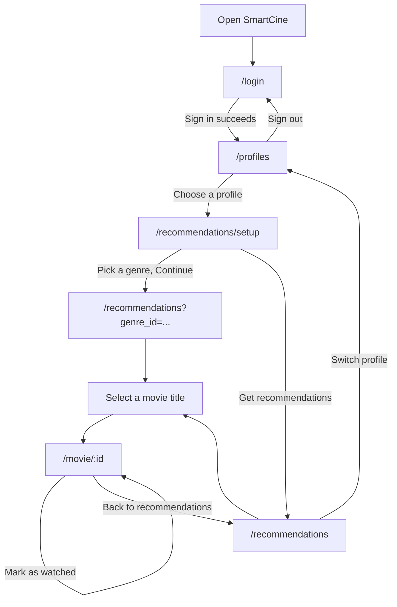

## 1. P0 stories and status
 
Status reflects what is on `main` at submission time. "Works" means the user can complete the story through the UI with real data. "Partly works" means the screen exists but one acceptance criterion is incomplete.
 
| Story | Screen(s) | Route(s) | Status | Issue |
|---|---|---|---|---|
| US10 — Select a profile before watching | Sign in, Who's watching? | `/login` → `/profiles` | Works | [#32](https://github.com/SE-FDA-NEU-AI66B/G7-AI66B-SOFTWARE_ENGINEERING-Topic_D2-Booking_Software/issues/32) |
| US06 — Ask for a theme before recommending | Genre picker | `/recommendations/setup` | Partly works — the genre filter only applies once a profile has 5 or more rated or watched movies; the cold-start list ignores it | [#27](https://github.com/SE-FDA-NEU-AI66B/G7-AI66B-SOFTWARE_ENGINEERING-Topic_D2-Booking_Software/issues/27), [#28](https://github.com/SE-FDA-NEU-AI66B/G7-AI66B-SOFTWARE_ENGINEERING-Topic_D2-Booking_Software/issues/28) |
| US01 — Cold-start recommendations | Recommendation list | `/recommendations` | Works | [#23](https://github.com/SE-FDA-NEU-AI66B/G7-AI66B-SOFTWARE_ENGINEERING-Topic_D2-Booking_Software/issues/23) |
| US03 — Personalized recommendations | Recommendation list | `/recommendations` | Works — genres the profile rates highest are listed first | [#25](https://github.com/SE-FDA-NEU-AI66B/G7-AI66B-SOFTWARE_ENGINEERING-Topic_D2-Booking_Software/issues/25) |
| US02 — Rate a watched movie | Movie detail | `/movie/:id` | Works | [#24](https://github.com/SE-FDA-NEU-AI66B/G7-AI66B-SOFTWARE_ENGINEERING-Topic_D2-Booking_Software/issues/24) |
| US04 — Exclude watched movies | Movie detail, recommendation list | `/movie/:id` → `/recommendations` | Works | [#26](https://github.com/SE-FDA-NEU-AI66B/G7-AI66B-SOFTWARE_ENGINEERING-Topic_D2-Booking_Software/issues/26) |
 
Screens outside the P0 stories:
 
| Route | Status |
|---|---|
| `/` (landing page) | Not started — signed-out visitors are redirected to `/login` |
| `/profile/ratings` (P1) | Not started — the route is not registered |
 
### Screen flow
 

 
Routes use hash URLs (for example `#/profiles`). A visitor without a session is sent to `/login`; a signed-in user without a chosen profile is sent to `/profiles`.
 
---